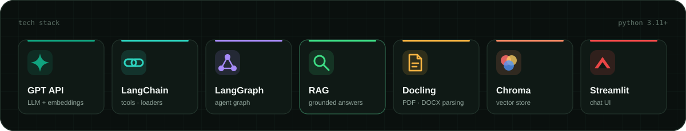
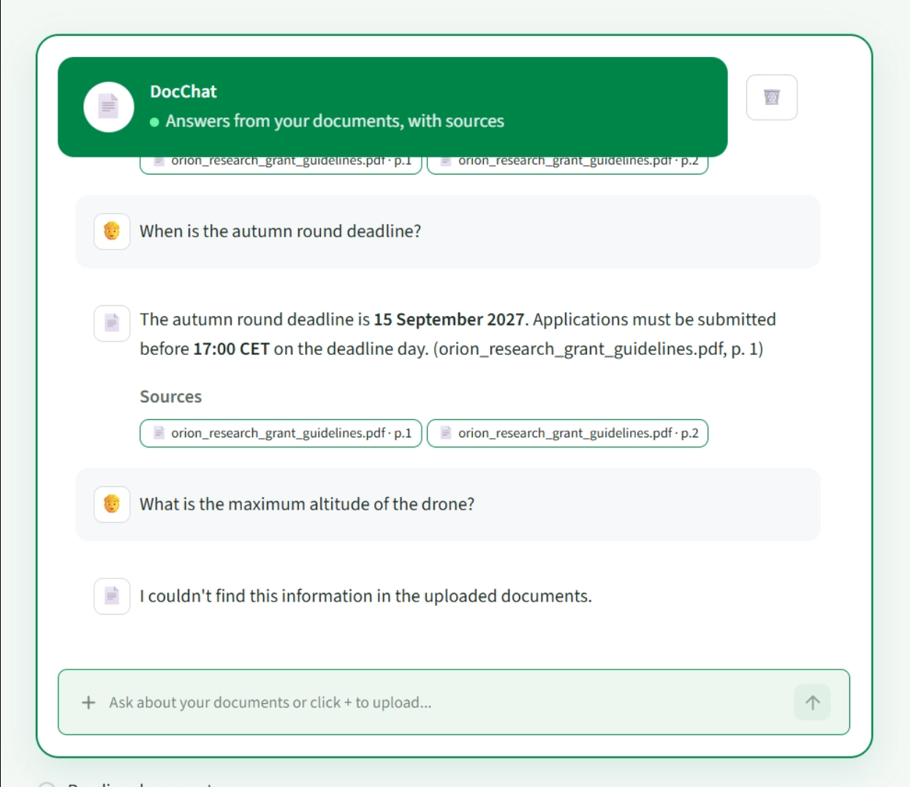
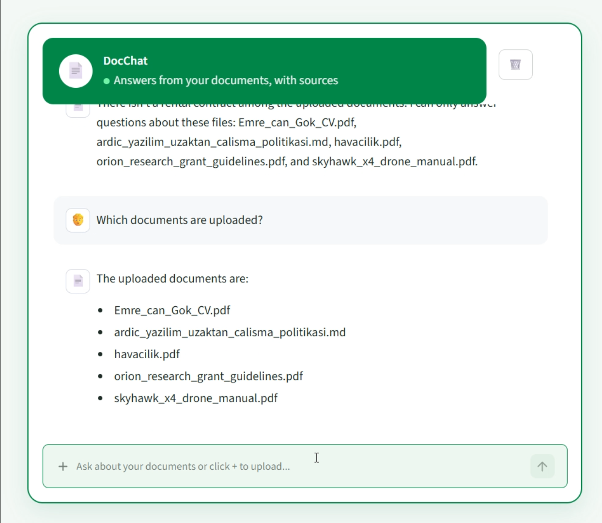

<p align="center">
  
</p>

<h3 align="center">Built by Emrecan Gök</h3>

<p align="center">
  <a href="https://github.com/Emrecangok"></a>
  <a href="https://www.linkedin.com/in/emrecan-g%C3%B6k-864b80248/"></a>
</p>

<p align="center">
  
  
  
  
  
  
</p>

**DocChat is a chatbot for your own documents.** Upload PDF, Word, PowerPoint, Excel, Markdown or HTML files and ask questions in plain language. An agent decides where to search, checks that what it found actually answers the question, and replies with the file and page it came from. If the answer isn't in your files, it says so instead of guessing.

<p align="center">
  
</p>

<!-- Demo: add docs/assets/demo.gif, then remove this comment line and the one below
<p align="center"></p>
-->

## Screenshots

<table>
  <tr>
    <td width="50%"></td>
    <td width="50%"></td>
  </tr>
  <tr>
    <td align="center"><sub>Answers with cited sources, and an honest "not found"</sub></td>
    <td align="center"><sub>Knows which documents are uploaded</sub></td>
  </tr>
</table>

## Features

- Upload files and ask a question in the same message
- Answers come only from the uploaded documents, with sources (`file · page`)
- The agent picks which document to search, or asks you when it can't tell
- Retrieved passages are graded for relevance; the query is rewritten if nothing fits
- Says "not found in your documents" instead of guessing
- Keeps the conversation short (last 6 messages) to control cost

## How it works

<p align="center">
  
</p>

| Node | What it does |
|---|---|
| `ingest` | Reads new files with Docling, splits them into chunks, stores them in Chroma |
| `agent` | LLM with two tools: `search_document` and `list_documents` |
| `run_tools` | LangGraph `ToolNode`; runs the tool the agent asked for |
| `grade_docs` | One LLM call decides if the retrieved chunks answer the question |
| `rewrite` | Writes a better search query and searches again (max 2 times) |
| `generate` | Writes the answer from the graded chunks, with citations |
| `fallback` | Used when nothing relevant is found after the retries |
| `trim` | When the chat reaches 12 messages, keeps the last 6 |

## Project structure

```
app.py        Streamlit chat UI
graph.py      LangGraph graph (nodes and edges)
nodes.py      Node functions and tools
state.py      Graph state
rag.py        Docling loading, chunking, Chroma vector store
llm.py        OpenAI chat model
config.py     Settings read from .env
prompts/      System, grade, rewrite and generate prompts
documents/    Uploaded files
chroma_db/    Vector store (created automatically)
```

## Setup

Python 3.11+ is required.

```bash
pip install streamlit langgraph langchain langchain-core langchain-openai langchain-chroma langchain-docling docling tiktoken python-dotenv
```

Create a `.env` file in the project folder:

```
OPENAI_API_KEY = sk-...
OPENAI_MODEL_NAME = gpt-6-luna
OPENAI_EMBEDDING_MODEL = text-embedding-3-small
OPENAI_TEMPERATURE = 0.2
OPENAI_MAX_RETRIES = 2

RAG_RETRIVER_K = 4
RAG_MAX_QUERY_RETRIES = 2
TRIM_TRIGGER = 12
TRIM_KEEP = 6
```

## Run

```bash
streamlit run app.py
```

Click **+** in the chat box to upload files, then ask a question. The first upload is slower because Docling loads its models.

## Notes

- If you change the embedding model, delete the `chroma_db/` folder and upload the files again. Vectors from different models can't be mixed.
- OCR is turned off for speed, so scanned PDFs (images of pages) won't produce text.
- `main.py` and `routers/` are a FastAPI skeleton that is not wired up yet.
